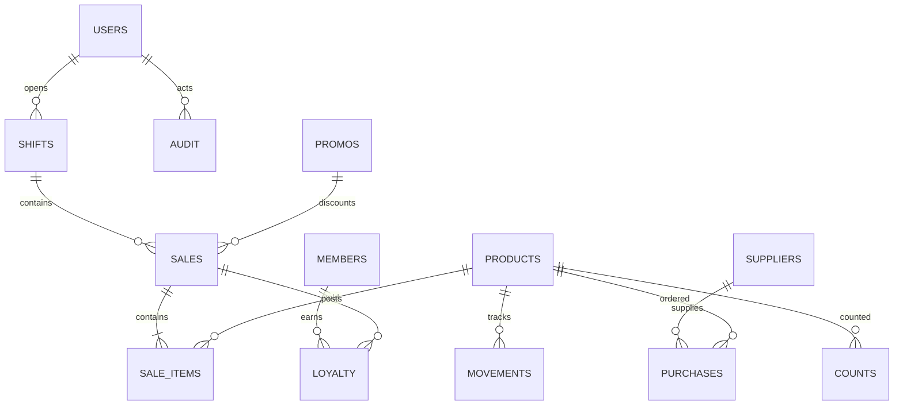

# Nilla Daily Mart — rancangan implementasi

## PRD dan batas rilis
Sistem satu toko, mata uang integer Rupiah, tanggal Asia/Makassar. Tujuan: transaksi dapat ditelusuri, stok dan poin konsisten, hak akses ditegakkan server. SQLite merupakan sumber data; browser tidak menyimpan catatan bisnis atau kredensial. Rilis ini untuk evaluasi lokal, bukan deklarasi siap produksi.

## Matriks hak akses yang diterapkan
| Fungsi | Owner | Manager | Kasir | Gudang |
|---|---|---|---|---|
| Penjualan, shift | Ya | Ya | Milik sendiri | Tidak |
| Katalog tanpa stok/HPP | Ya | Ya | Ya | Ya |
| Persediaan, mutasi | Ya | Ya | Tidak | Ya, tanpa HPP |
| Produk dan pemasok | Kelola | Baca | Tidak | Baca |
| PO | Buat/setujui | Usulkan | Tidak | Baca penerimaan |
| Penerimaan PO disetujui | Ya | Ya | Tidak | Ya |
| Stock opname | Usulkan/setujui pihak lain | Usulkan | Tidak | Usulkan |
| Refund | Setujui | Tidak | Tidak | Tidak |
| Member | Kelola | Kelola | Daftar/baca | Tidak |
| Promo | Buat/setujui | Usulkan | Gunakan | Tidak |
| Keuangan, audit, pengguna | Ya | Tidak | Tidak | Tidak |
| Analitik operasional | Ya | Ya | Tidak | Tidak |

## Alur bisnis
- Login → buka shift → keranjang → quote server → konfirmasi tunai → transaksi atomik → struk → tutup shift dan hitung selisih.
- PO diajukan → owner menyetujui → gudang menerima sebagian/seluruhnya → stok, weighted average cost dan utang bertambah → owner membayar utang terpisah dari HPP.
- Hitung fisik → usulan selisih dengan saldo acuan → owner selain pengusul menyetujui → tolak usulan basi bila stok berubah → mutasi stok.
- Promo diajukan → owner setujui → validasi tanggal/hari/kuota/member/minimum/margin oleh server saat quote dan checkout.
- Penjualan → ledger poin earned/redeemed → refund penuh oleh owner → pembalikan stok, kas, dan ledger poin. Refund ditolak bila poin hasil penjualan sudah dipakai sehingga saldo menjadi negatif.

## Arsitektur dan integritas
Node launcher → server Python standard library → SQLite WAL, foreign keys, BEGIN IMMEDIATE. Transaksi penjualan memuat sale, items, cash payment, stock movements, loyalty ledger dan audit dalam satu commit. Kunci idempotensi unik mencegah pengulangan pembayaran. Harga dan HPP diambil server; nilai dari browser tidak dipercaya. Kata sandi scrypt dengan salt, cookie HttpOnly SameSite=Strict, sesi kedaluwarsa, pemeriksaan origin dan header untuk mutasi, pembatasan login. Hanya aset publik terdaftar yang dilayani.

## UI
Kasir dibuka pada layar penjualan tanpa stok dan modal. Gudang dibuka pada persediaan dan penerimaan. Manager melihat ringkasan operasional dan pengajuan. Owner melihat sumber angka keuangan, audit, persetujuan, dan pengguna. Form konfirmasi pembayaran dan penyesuaian menampilkan konsekuensi sebelum submit.

## Status pengembangan
Implementasi inti dan hasil tes dicatat di README. Rancangan lanjutan: FEFO/batch, multi lokasi, PO multi-item dalam satu dokumen, retur parsial/rusak, akuntansi perpajakan, seluruh 16 jenis promo, tier yang dapat diatur, ledger double-entry, AI eksternal, prediksi terkalibrasi, MFA dan pemulihan akun. Jangan menyebut seluruh master prompt sudah selesai.
